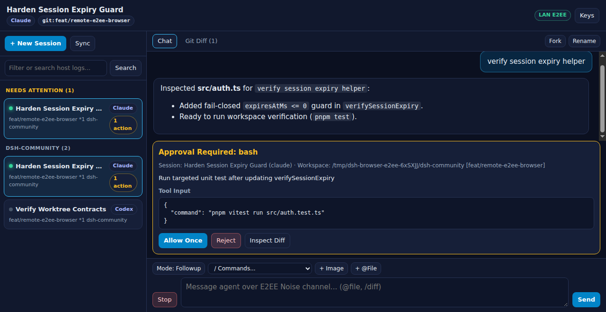
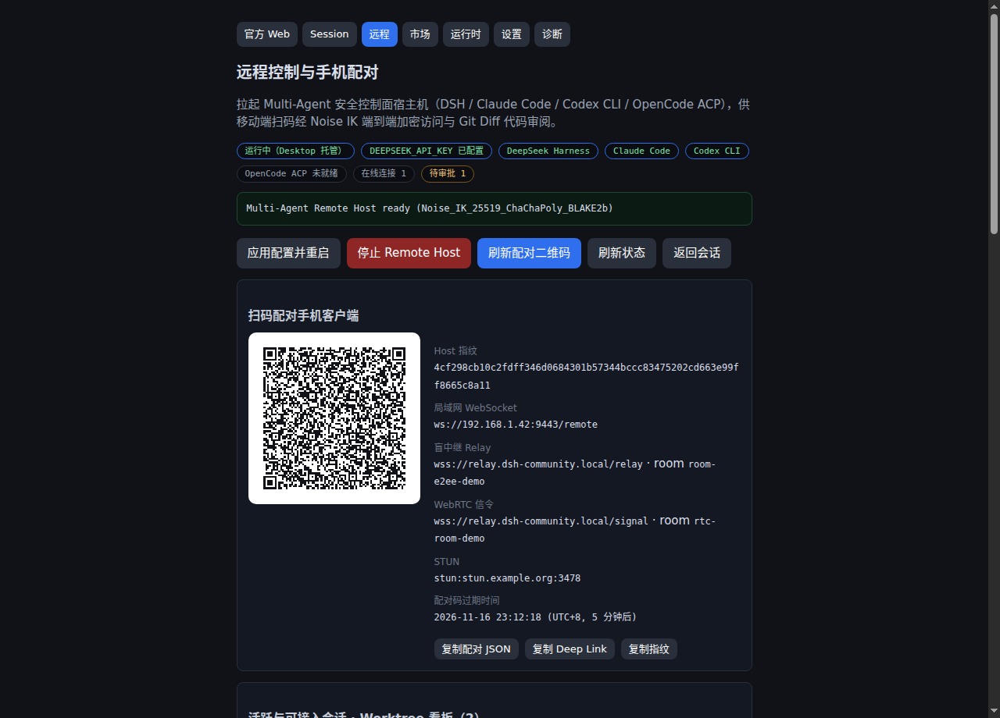

# DSH Community

[简体中文](README.md) | **English**

[](https://github.com/kamanager2012/dsh-community/actions/workflows/ci.yml)
[](https://github.com/kamanager2012/dsh-community/releases/latest)
[](https://github.com/deepseek-ai/deepseek-harness)
[](LICENSE)

> **DSH Community is the Linux / WSL2 complementary distribution and compatibility layer for the official [DeepSeek Harness](https://github.com/deepseek-ai/deepseek-harness).** We ship a TUI, signed Linux AppImage, exact upstream Runtime pin and optional E2EE multi-agent remote. **We do not fork the official kernel. Only DSH sessions live in official `~/.dsh`; Claude Code, Codex and OpenCode keep their native session stores.**

**Try the current community changes:** [v0.2.2-rc.3-community.1 (Pre-release)](https://github.com/kamanager2012/dsh-community/releases/tag/v0.2.2-rc.3-community.1). **Official-core-mirrored Latest:** [v0.2.2-rc.3](https://github.com/kamanager2012/dsh-community/releases/latest). These are separate release channels; the pre-release does not replace Latest.

## Choose by the job, not a feature checklist

| Your main need | Start here | Why |
|---|---|---|
| **Official DSH** on Linux / WSL2: TUI, AppImage, native session continuity | **DSH Community** | Linux complementary distribution, upstream compatibility and verifiable builds |
| Durable terminal panes, SSH and many CLI agents | [Herdr](https://github.com/herdrdev/herdr) | Terminal multiplexing and persistent processes |
| General mobile/desktop multi-agent workflows | [Happier](https://github.com/happier-dev/happier), [Paseo](https://github.com/getpaseo/paseo), [T3 Code](https://github.com/pingdotgg/t3code) | Existing mobile, worktree and PR-oriented alternatives |
| Native DSH Desktop remote workflows | [DS Harness Remote](https://github.com/liguobao/ds-harness-remote) | Official DSH plugin-first remote model |

Multi-agent dashboards, E2EE, remote approvals and Git diff are **not exclusive** to us. See [**sourced positioning and alternatives**](docs/competitive-positioning.en.md) (public docs as of 2026-11-17; not a hands-on benchmark).

---


## UI Previews (Chromium E2EE Harness & Desktop Console Page)

| Browser PWA E2EE Harness (Chromium + BlindGateway + simulated engine fixtures) | Desktop Remote Console HTML Preview (test fixture state & expired demo QR) |
|---|---|
|  |  |

> **Evidence boundary for these screenshots**: both images are generated by the headless harness [`scripts/e2e/remote-web-browser-e2ee.mjs`](scripts/e2e/remote-web-browser-e2ee.mjs) (see [Workflow Run 43900107856](https://github.com/kamanager2012/dsh-community/actions/runs/43900107856)). The left capture runs the built `apps/remote-web` PWA in real headless Chromium over `Noise_IK_25519_ChaChaPoly_BLAKE2b` against a local `BlindGatewayServer`, **using simulated Claude/Codex session, approval, and Git diff fixtures**. The right capture renders the Desktop `renderDesktopRemoteHtml` view with **synthetic status data and expired `*.dsh-community.local` pairing metadata** — it is **not** a physical Electron window screenshot driving live external CLI processes.

---

> **Real Linux first-run evidence:** [CI workflow](.github/workflows/linux-first-run-smoke.yml) and [scope guide](docs/first-run-smoke.md) test a pinned source installation and CLI startup without a model key; not proof of physical WSL2 or live Agent execution.

## 30-Second Quick Start

### 1. WSL / Linux Terminal Source Installer (`dsh-community` & `dsh-marketplace`)

`scripts/install-linux.sh` landed on `main` **after** the `v0.2.2-rc.3` release tag; it is a source-build helper requiring **Node.js 24.9+** (official `@deepseek-ai/dsh@0.2.2-rc.3` declares `engines.node >=24.9.0`; workspace minimum is `22.15+`, passing CI on Node 22 & 24), **`pnpm`**, and **`git`** (not a zero-dependency binary):

```sh
# Option A: track latest main source (includes the installer & post-rc.3 fixes)
curl -fsSL https://raw.githubusercontent.com/kamanager2012/dsh-community/main/scripts/install-linux.sh | bash

# Option B: pin an immutable tag & verified commit SHA (v0.2.2-rc.3 = 073826c38df4cf246e7ac90b27e0df98569a534d)
curl -fsSL https://raw.githubusercontent.com/kamanager2012/dsh-community/main/scripts/install-linux.sh | \
  bash -s -- --ref v0.2.2-rc.3 --expected-commit 073826c38df4cf246e7ac90b27e0df98569a534d
```

Then run directly (shares `~/.dsh` sessions with official `dsh`):

```sh
export DEEPSEEK_API_KEY=...
dsh-community                 # resume latest ~/.dsh session or start a new one
dsh-community doctor          # environment preflight (never prints keys)
dsh-marketplace list          # inspect tested plugins and 0.1.1-rc.2 compatibility notices
```

#### Remote Control Scenarios & Least-Privilege `approve` Authorization

- **Scenario A — Same-machine browser PWA demo (`127.0.0.1` is loopback-only; scanning it from a phone connects back to the phone itself)**:
  ```sh
  dsh-community remote gateway --serve-web --port 8787 &
  dsh-community remote start --engines dsh,claude,codex,opencode \
    --relay-url ws://127.0.0.1:8787/relay \
    --signaling-url ws://127.0.0.1:8787/signal \
    --web-url http://127.0.0.1:8787/app/ --qr
  ```
- **Scenario B — Cross-device / mobile control (LAN Android APK via `--host <LAN-IP> --mdns`, or TLS `https://`/`wss://` reverse proxy for Mobile Browser PWA & WAN)**:
  ```sh
  # Direct LAN pairing for the Android client APK (replace <LAN-IP> with your host LAN IP):
  dsh-community remote start --engines dsh,claude,codex,opencode --host <LAN-IP> --mdns --qr

  # Cross-network or mobile browser PWA (front `remote gateway` with Caddy/Nginx TLS + `--host-secret` per deploy/relay/README.md;
  # the separately launched host requires matching registration credentials in both env vars):
  DSH_REMOTE_RELAY_HOST_SECRET="replace-with-strong-secret" \
  DSH_REMOTE_SIGNALING_HOST_SECRET="replace-with-strong-secret" \
  dsh-community remote start --engines dsh,claude,codex,opencode \
    --relay-url wss://remote.example.com/relay \
    --signaling-url wss://remote.example.com/signal \
    --web-url https://remote.example.com/app/ --qr
  ```
  > Note: newly paired devices receive **only `['observe', 'prompt']`** by default (read sessions/files/Git diff and send prompts) — passing `--allow-caps observe,prompt,approve` only raises the pairing token's **maximum capability ceiling** (`DSH_REMOTE_ALLOWED_CAPS`); it does **not** automatically grant `approve`. To allow tool approvals (`Allow Once` / `Reject` via `approval.respond`), the host must explicitly confirm with `confirm <candidateId> observe,prompt,approve` (or check `approve` in Desktop UI, when included in `--allow-caps`), or grant post-pairing via `dsh-community remote grant <deviceId> approve`. Binding `remote gateway` to non-loopback/wildcard addresses fails closed without `--host-secret`.
  > Security boundary: `Noise_IK_25519_ChaChaPoly_BLAKE2b` encrypts application payloads over the remote transport link so the self-hosted blind relay forwards opaque ciphertext. It does **not** encrypt or alter model provider API calls (DeepSeek / Anthropic / OpenAI), authorized `observe` clients can read uncommitted working-tree `git diff`s (keep accidental secrets out of dirty worktrees), and no independent third-party cryptographic security audit has been completed yet.

### 2. Or Download Signed `v0.2.2-rc.3` Linux AppImage / Android APK

Grab `v0.2.2-rc.3` (release commit `073826c`) `.AppImage` (Linux Desktop) or `-android-arm64-v8a.apk` (Android 8.0+ Preview APK; CI `x86_64` emulator E2EE verified, physical `arm64-v8a` handset telemetry `[UNVERIFIED]`) from [`releases/latest`](https://github.com/kamanager2012/dsh-community/releases/latest) (**12 uploaded assets total**: 3 primary artifacts — AppImage, APK, CycloneDX SBOM — plus 3 `.sha256` files and 6 keyless Cosign `.sigstore.json` bundles, excluding GitHub's auto-generated source tarballs):

```sh
chmod +x dsh-community-*.AppImage && sha256sum -c dsh-community-*.AppImage.sha256
./dsh-community-*.AppImage

sha256sum -c dsh-community-*-android-arm64-v8a.apk.sha256
adb install dsh-community-*-android-arm64-v8a.apk
```

<details>
<summary>Run from source checkout / package AppImage locally / Cosign verification</summary>

```sh
git clone https://github.com/kamanager2012/dsh-community.git && cd dsh-community
pnpm install
export DEEPSEEK_API_KEY=...

pnpm start                    # Terminal TUI (new / resume / sessions / plugins / run doctor)
pnpm desktop                  # Launch Electron shell from source
pnpm marketplace -- list      # Plugin discovery CLI
pnpm desktop:package -- --appimage   # Local Linux AppImage (unsigned preview)
```

Cosign keyless verification and exact release filenames: [`docs/release.md#artifact-signing-keyless`](docs/release.md#artifact-signing-keyless) · Current release ledger: [`docs/current-release.md`](docs/current-release.md) · Cross-network TLS reverse proxy setup: [`deploy/relay/README.md`](deploy/relay/README.md) & [`docs/remote-host-client.md`](docs/remote-host-client.md).

</details>

---

## Highlights

- **Shared `~/.dsh` Across Official & Three Complementary Community Endpoints** — Official `deepseek-ai/deepseek-harness` owns the execution kernel, Web UI, and Windows/macOS Desktop (`win-x64`, `mac-arm64`, `mac-x64`). `dsh-community` delivers the **three complementary community endpoints** absent upstream: **WSL/Linux Terminal**, **Linux Desktop AppImage**, and **Android Remote Client APK** (`dsh-community-*-android-arm64-v8a.apk` shipped in [Published Latest](https://github.com/kamanager2012/dsh-community/releases/latest); CI `x86_64` emulator E2EE verified, physical `arm64-v8a` handset telemetry `[UNVERIFIED]`).
- **Multi-Agent E2EE Remote Control Plane (`packages/remote-adapter`)** — Steer **DSH, Claude Code, Codex CLI, and OpenCode ACP** from the zero-install Browser PWA ([`apps/remote-web`](apps/remote-web/)) or signed Android preview APK over `Noise_IK_25519_ChaChaPoly_BLAKE2b`, LAN mDNS, WebRTC P2P, or self-hosted Blind Relay ([`deploy/relay/`](deploy/relay/)) — with least-privilege default `observe,prompt` pairing (`approve` granted separately). Validated end-to-end in headless Chromium against **simulated agent fixtures** for Noise IK pairing, `tool_use` approval, and read-only Git diff inspection (broad live-CLI matrix coverage remains ongoing), plus explicit compatibility warnings for legacy `0.1.1-rc.2` plugins.
- **Supply-Chain Verified Releases (12 Uploaded Assets) & Clear `rc.3` vs Pre-release Boundary** — `v0.2.2-rc.3` (`073826c`) remains `Published Latest` with 3 primary artifacts (`.AppImage`, `arm64-v8a` `.apk`, CycloneDX SBOM) + 3 `.sha256` files + 6 keyless Cosign `.sigstore.json` bundles verified via `artifact-smoke` and `user-loop-evidence.yml`; post-`rc.3` fixes (`install-linux.sh`, Chromium E2EE acceptance, fail-closed `observe` Git diff secret redaction, and Codex/ACP crash recovery) are now also signed and published as GitHub **Pre-release** [`v0.2.2-rc.3-community.1`](https://github.com/kamanager2012/dsh-community/releases/tag/v0.2.2-rc.3-community.1) (`artifact-smoke` [Run 44005955539](https://github.com/kamanager2012/dsh-community/actions/runs/44005955539) PASS across all 12 assets, without displacing `v0.2.2-rc.3` Latest).

---

## Why Choose DSH Community?

First, what the official project ships (from the upstream `deepseek-ai/deepseek-harness` source, checked 2026-11-15):

| Official offering | Details |
|---|---|
| Web UI | `npx @deepseek-ai/dsh web`; reachable from other machines' browsers through a reverse proxy plus a launch token |
| Windows / macOS Desktop | Electron shell (`win-x64`, `mac-arm64`, `mac-x64`); the official packaging docs state **Linux is not a supported Desktop release target** |
| `dsh` launcher | Boots profiles such as `web` / `headless` / `sdk` / `acp`; **ships no terminal UI of its own**, and upstream has no TUI package |
| Python SDK, ACP server | For programmatic use, not interactive UIs |

Multi-agent dashboards, mobile approvals, E2EE and Git diffs already have strong alternatives. **We do not claim exclusivity, count features as a benchmark, or use static Star rankings.** A missing README mention is not proof a competitor lacks a feature.

| Project | When it is a better starting point |
|---|---|
| [Herdr](https://github.com/herdrdev/herdr) | Persistent panes, SSH and terminal-native CLI agent coordination |
| [Happier](https://github.com/happier-dev/happier) | General multi-agent mobile/desktop orchestration, E2EE and self-hosting |
| [Paseo](https://github.com/getpaseo/paseo) | Integrated worktrees, editor, terminal, diffs and PR workflow |
| [T3 Code](https://github.com/pingdotgg/t3code) | Multi-agent sessions flowing to branches and GitHub PRs |
| [DS Harness Remote](https://github.com/liguobao/ds-harness-remote) | Native DSH plugin-based remote workflows, P2P/TURN and additional ACP providers |
| [dsh-Go](https://github.com/ccch1mneyyy/dsh-Go) | Running DSH locally on an Android phone rather than using a thin remote client |
| [dsh-TUI](https://github.com/ccch1mneyyy/dsh-TUI) | A rich independent DSH terminal UI |
| **DSH Community** | Unmodified official DSH Runtime on Linux/WSL2: TUI, signed AppImage, official session continuity, precise upstream pins and verifiable releases |

**Our substantiated difference:** official `@deepseek-ai/dsh` owns execution and DSH Sessions (`~/.dsh`); Community owns Linux distribution, compatibility and optional remote. Claude Code, Codex CLI and OpenCode **retain their own native Session stores**; a shared UI does not imply a shared session database.

**Unverified limits:** Android physical `arm64-v8a` remains `[UNVERIFIED]`, with no native iOS client. Broader real third-party CLI and network combinations require field evidence. E2EE does not cover model-provider boundaries or imply an independent security audit.

For AppImage/APK/CycloneDX SBOM, SHA-256 and Cosign evidence see [release facts](docs/current-release.md). For methods and source links see [competitive positioning](docs/competitive-positioning.en.md). Submit redacted [first-run feedback](https://github.com/kamanager2012/dsh-community/issues/new?template=first-run-feedback.yml).


---

## Quick Start

### 1. Download Signed Linux AppImage or Android APK

Grab the latest `.AppImage` (for Linux Desktop) or `-android-arm64-v8a.apk` (for Android 8.0+ `arm64-v8a` phones) from [Published Latest](https://github.com/kamanager2012/dsh-community/releases/latest), verify SHA-256 + Keyless Cosign signatures, and launch:

```sh
# See docs/current-release.json for exact filenames in Published Latest:
# https://github.com/kamanager2012/dsh-community/releases/latest

# Linux Desktop AppImage:
chmod +x dsh-community-*.AppImage
sha256sum -c dsh-community-*.AppImage.sha256
./dsh-community-*.AppImage

# Android Remote Client APK (verify checksum before installing via adb or on-device):
sha256sum -c dsh-community-*-android-arm64-v8a.apk.sha256
adb install dsh-community-*-android-arm64-v8a.apk
```

Verification guide: [`docs/release.md#artifact-signing-keyless`](docs/release.md#artifact-signing-keyless) · Current release ledger: [`docs/current-release.md`](docs/current-release.md)

### 2. Run from Source (WSL / Linux Terminal, Desktop, or Multi-Agent Remote)

Requirements: Node.js 24.9+ (official `@deepseek-ai/dsh@0.2.2-rc.3` declares `engines.node >=24.9.0`; this workspace requires at least 22.15 and CI passes on Node 22), pnpm, and either a configured `DEEPSEEK_API_KEY` (for DSH / hybrid mode) or local **Claude Code / Codex CLI / OpenCode** binaries on `PATH` (for standalone Multi-Agent Remote Control Plane mode).  
Since official `0.1.0-rc.8`, session JSONL uses `node:zlib` zstd APIs added in Node 22.15. Sessions continue to use the official `~/.dsh` data source.

```sh
git clone https://github.com/kamanager2012/dsh-community.git
cd dsh-community
pnpm install
export DEEPSEEK_API_KEY=...

# WSL/Linux TUI (resume latest ~/.dsh conversation or start a new one)
pnpm start
pnpm new
pnpm sessions            # list official session history
pnpm run doctor          # diagnostics (not bare `pnpm doctor` — that is pnpm's own command)

# Linux Desktop shell (with built-in Marketplace & Remote QR tab)
pnpm desktop

# Multi-Agent E2EE Remote Control Plane (build once first):
pnpm build
# 1) Same-machine browser PWA demo only (127.0.0.1 is unreachable from a phone):
pnpm start -- remote gateway --serve-web --port 8787 &
pnpm start -- remote start --engines claude,codex,opencode \
  --relay-url ws://127.0.0.1:8787/relay \
  --signaling-url ws://127.0.0.1:8787/signal \
  --web-url http://127.0.0.1:8787/app/ --qr
# 2) Grant tool approval separately after pairing (default capabilities are observe,prompt):
pnpm start -- remote grant <deviceId> approve
```

For cross-machine / mobile pairing, use `--host <LAN-IP> --mdns` for the Android APK on LAN, or front `remote gateway` with a TLS reverse proxy per [`deploy/relay/README.md`](deploy/relay/README.md) and see [`docs/remote-host-client.md`](docs/remote-host-client.md).

Useful CLI subcommands (`dsh-community` or `dsh-community-tui`): `new`, `resume last`, `sessions`, `doctor`, `version`, `plugins` (read-only catalog view; install stays on official `dsh plugin add` / Desktop marketplace), `desktop`, and `remote`.

Package Linux Desktop locally (unsigned preview):

```sh
pnpm desktop:package
./apps/desktop/release/linux-unpacked/dsh-community

pnpm desktop:package -- --appimage
```

---

## Endpoints & Source/Release State

> **One Harness. Three complementary community endpoints — all published in Latest; Android physical `arm64-v8a` handset telemetry remains `[UNVERIFIED]`.**  
> Runtime, Session, plugin execution, Official Web, and Win/macOS Desktop belong to upstream `deepseek-ai/deepseek-harness`; historical Windows/macOS installers were retired after `v0.1.1-rc.2` (`--win` / `--mac` fail closed). Earlier independent numbers `v0.1.2`–`v0.1.6` are historical only.

| Surface | Owner | Entry |
|---|---|---|
| Official Web & Win/macOS Desktop | Upstream [`deepseek-ai/deepseek-harness`](https://github.com/deepseek-ai/deepseek-harness) | `npx @deepseek-ai/dsh web` / upstream desktop releases |
| WSL/Linux Terminal / TUI | **Complementary Endpoint 1 (Shipped)** | `dsh-community` / `pnpm start` / `pnpm tui` |
| Linux Desktop AppImage | **Complementary Endpoint 2 (Shipped)** | [Published Latest](https://github.com/kamanager2012/dsh-community/releases/latest) `.AppImage` |
| Android Remote Client | **Complementary Endpoint 3 (Shipped APK; physical `arm64-v8a` `[UNVERIFIED]`)** | [Published Latest](https://github.com/kamanager2012/dsh-community/releases/latest) `-android-arm64-v8a.apk` (`apps/android` + `packages/remote-adapter`, [architecture](docs/remote-host-client.md)) |
| Multi-Agent E2EE Remote Control Plane | Community Control Plane (`packages/remote-adapter`) | `dsh-community remote start --qr` / Desktop "远程" tab |
| Verified Community Plugins | Compatibility Catalog (Not Awesome List) | Desktop marketplace tab / `pnpm marketplace -- list` / [`catalog.json`](packages/marketplace/catalog.json) |
| Engineering & Ops Handbook | Documentation & AI Retrieval Catalog | [Online Handbook](https://kamanager2012.github.io/dsh-community/) · [`handbook/`](handbook/) |

**Candidate Source and Published Latest are independent states.**  
Source may advance to a newer reviewed upstream `@deepseek-ai/dsh` candidate while GitHub Latest, published installers, plugin `testedDsh`, and real User-Loop evidence remain on the last version that actually passed those gates. Do not infer workspace version from `releases/latest`, and never synthesize installer names from an unpublished candidate.

| State | Source of truth |
|---|---|
| **Published Latest** | [releases/latest](https://github.com/kamanager2012/dsh-community/releases/latest) — exact tag, asset names, release ID, and asset evidence live in [`docs/current-release.json`](docs/current-release.json) |
| **Candidate Source** | `candidateTag`, official-core pin (`packages/dsh-bridge/src/pin.ts`), workspace product version, and Dual-Badge live in [`docs/current-release.json`](docs/current-release.json) (`latest-tested.json` is compatibility evidence, not the pin source of truth) |
| **Historical / Pre-release** | [Releases](https://github.com/kamanager2012/dsh-community/releases) |

Read the locked endpoint definition in [Community endpoints](docs/community-endpoints.en.md) and start-to-finish onboarding in [Getting Started](docs/getting-started.en.md).

---

## Architectural Boundary & Success Criteria

`dsh-community` must **not vendor** official `packages/*` (`Official Source Ownership = 0`), must **not** `patch-package` official UI, must **not** fork the official event vocabulary, and must **not** maintain a second equivalent Session source of truth.

| Official Runtime owns | This repository owns |
|---|---|
| Agent loop and model execution | Complementary Desktop AppImage, Android Remote APK, and TUI distribution/UX |
| Tool execution and Runtime lifecycle | Lifecycle wrapping, diagnostics, and upstream compatibility contracts |
| Official Session persistence and event surface | Session selection, resume UX, and E2EE multi-agent adapters |
| Official CLI, profiles, and plugin surface | Keyless release packaging, plugin security metadata, and ecosystem links |

1. Official Source Ownership = 0 (zero vendored official code).
2. TUI patch-surface on official Cordis rows drops toward zero.
3. TUI/Desktop/Android do not implement Agent loop, Session persistence, or Tool execution.
4. One upstream rc bump requires zero business UI edits in principle.
5. WSL/Linux TUI, Linux AppImage, Android Remote Client, and official Web/Desktop share the same session truth (`~/.dsh`).
6. Upstream regressions break in contract CI before user release.

Currently: criteria 1, 3, and 5 hold by design; criterion 2 community overlay touches official rows without mounting third-party TUIs; criterion 4 is verified against upstream releases.

---

## Repository Map & Layout

[`dsh-community`](https://github.com/kamanager2012/dsh-community) is the **only canonical community download entry**. The former standalone repositories `dsh-marketplace`, `dsh-community-plugins`, `dsh-community-edition`, and `deepseek-harness-suite` were merged into this repository and deleted on 2026-09-13.

```text
contracts/              Official CLI and package surface snapshots + compatibility matrix
packages/dsh-bridge     Runtime process and lifecycle boundary
packages/marketplace    Plugin discovery CLI + audited catalog.json
packages/remote-adapter Multi-Agent E2EE control plane (DSH, Claude Code, Codex CLI, OpenCode ACP + scoped Git diff review) over Noise IK & LAN/WebRTC/Relay
packages/tui            Community terminal UI library (@dsh-community/tui-surface, Ink-based)
packages/tui-adapter    Community TUI adapter and patch surface
packages/shared-types   Community-owned types, not an official event fork
apps/desktop            Official `dsh web` Electron shell + session list + Marketplace/Remote UI
apps/remote-web         Browser PWA client for E2EE remote control
apps/android            Android Remote Client (shipped arm64-v8a APK; CI x86_64 emulator E2EE PASS, physical arm64-v8a [UNVERIFIED])
apps/tui                Official profile / resume launcher (`dsh-community`)
deploy/                 Self-hosted blind relay deployment configurations (`deploy/relay/`)
handbook/               Bilingual engineering handbook (`mkdocs`) & AI retrieval catalog
archive/                Frozen historical Labs (`archive/deepseek-harness-suite/`, excluded from build/CI)
tests/upstream-contract Compatibility, vendor=0, security, and release-gate contract checks
```

Further reading: [Getting Started](docs/getting-started.en.md) · [ARCHITECTURE.md](ARCHITECTURE.md) · [ECOSYSTEM.md](ECOSYSTEM.md) · [Release Guide](docs/release.md) · [Remote Host-Client](docs/remote-host-client.md) · [Contracts](contracts/README.md) · [Handbook](https://kamanager2012.github.io/dsh-community/).

## Evidence Language & Security

Use explicit status labels (`[REAL]`, `[PARTIAL]`, `[LABS]`, `[PROBE]`, `[FAIL-CLOSED]`, `[BLOCKED_BY_UPSTREAM]`, `[UNVERIFIED]`). A green unit test, successful fallback, or README statement is not proof of a real Runtime E2E.

See [SECURITY.md](SECURITY.md) for Desktop Electron hardening (`contextIsolation`, default-deny permissions, allow-listed navigation), keyless cosign signature verification, `~/.dsh` session-sharing boundaries, and private vulnerability reporting.

## Community & License

[Contributing](CONTRIBUTING.md) · [Governance](GOVERNANCE.md) · [Code of Conduct](CODE_OF_CONDUCT.md) · [Support](SUPPORT.md) · [Security](SECURITY.md)

MIT. Official runtime and third-party notices are documented in [NOTICE](NOTICE) and upstream `@deepseek-ai/dsh` package metadata.
