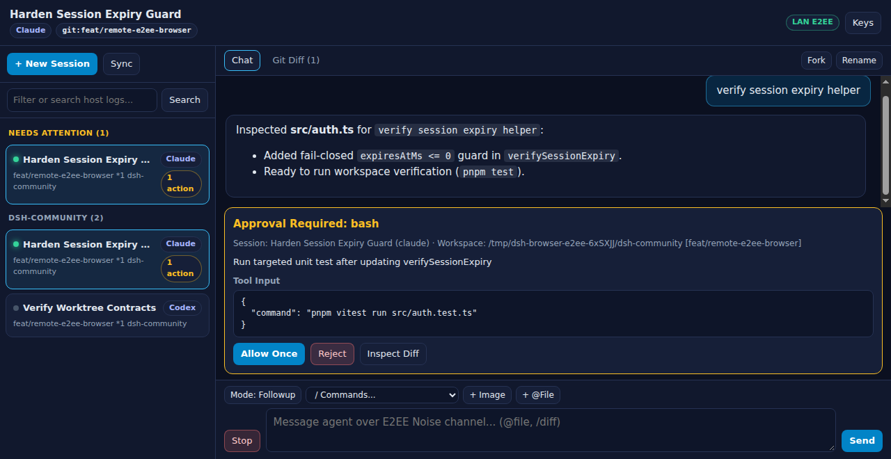
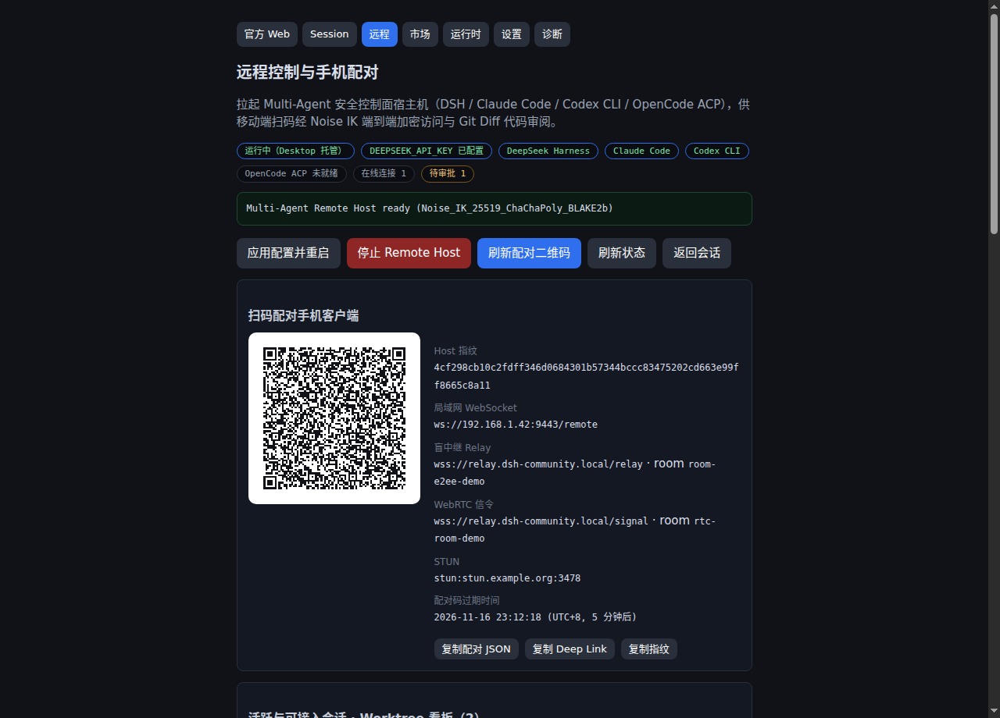

# DSH Community

**简体中文** | [English](README.en.md)

[](https://github.com/kamanager2012/dsh-community/actions/workflows/ci.yml)
[](https://github.com/kamanager2012/dsh-community/releases/latest)
[](https://github.com/kamanager2012/dsh-community/releases/tag/v0.2.2-rc.5-community.1)
[](https://github.com/deepseek-ai/deepseek-harness)
[](LICENSE)

> **DSH Community 是围绕官方 [DeepSeek Harness](https://github.com/deepseek-ai/deepseek-harness) 的 Linux / WSL2 社区发行与兼容层**：提供 TUI、签名 Linux AppImage、官方 Runtime 精确锁定和可选 E2EE 多 Agent 远控。**不修改官方执行内核；只有 DSH 会话使用官方 `~/.dsh`，Claude Code / Codex / OpenCode 使用各自原生会话存储。**

**试用最新社区精选插件预发布：** [v0.2.2-rc.5-community.1（Pre-release）](https://github.com/kamanager2012/dsh-community/releases/tag/v0.2.2-rc.5-community.1)（含 18 款精选插件目录与 Desktop/CLI 新手精选套装一键安装，`artifact-smoke` [Run 44516999116](https://github.com/kamanager2012/dsh-community/actions/runs/44516999116) 12 文件全检）；**官方内核对齐的 Latest：** [v0.2.2-rc.5](https://github.com/kamanager2012/dsh-community/releases/latest)（`artifact-smoke` [Run 44454406621](https://github.com/kamanager2012/dsh-community/actions/runs/44454406621)）。两条发布频道独立，前者不会覆盖 Latest。

## 选工具先看你的主要任务

| 你最需要 | 推荐起点 | 原因 |
|---|---|---|
| Linux / WSL2 使用**官方 DSH Runtime**，要 TUI、AppImage、官方会话接续 | **DSH Community** | 专注 Linux 互补发行、官方兼容性和可核验安装包 |
| 管理持久终端、SSH、多 Agent pane | [Herdr](https://github.com/herdrdev/herdr) | 主攻终端复用与持久进程 |
| 手机跨端管理多个 Agent | [Happier](https://github.com/happier-dev/happier)、[Paseo](https://github.com/getpaseo/paseo) 或 [T3 Code](https://github.com/pingdotgg/t3code) | 已有跨设备编排、Worktree、PR 等不同深度的方案 |
| 已经使用官方 DSH Desktop，重点是远程访问 | [DS Harness Remote](https://github.com/liguobao/ds-harness-remote) | DSH 原生插件与远控方向更直接 |

这里不把多 Agent、E2EE、手机审批或 Git Diff 当作独占卖点。完整竞品依据与限制：[**选型与竞争定位**](docs/competitive-positioning.md)（2026-11-17，公开文档核对，非实机对抗测试）。

---


## 界面预览（Chromium E2EE 联调与桌面控制台页面）

| Browser PWA E2EE 联调（Chromium + 本地 BlindGateway + 模拟多引擎夹具） | Desktop 远程控制台 HTML 预览（测试配对码 `*.dsh-community.local` 与视图渲染） |
|---|---|
|  |  |

> **截图证据边界说明**：两张图片由无头集成脚本 [`scripts/e2e/remote-web-browser-e2ee.mjs`](scripts/e2e/remote-web-browser-e2ee.mjs) 自动生成（见 [Workflow Run 43900107856](https://github.com/kamanager2012/dsh-community/actions/runs/43900107856)）——左图在真实无头 Chromium 中运行构建后的 `apps/remote-web` 并通过 `Noise_IK_25519_ChaChaPoly_BLAKE2b` 连接本地 `BlindGatewayServer`，**后端对话、审批与 Git Diff 使用模拟 Claude/Codex 夹具**；右图为 Desktop `renderDesktopRemoteHtml` 视图模板渲染结果（测试状态与已过期演示配对二维码），**并非物理 Electron 客户端运行真实外部 CLI 进程的现场截屏**。

---

> **Linux 首次安装真实验收：** [CI 工作流](.github/workflows/linux-first-run-smoke.yml) · [证据边界说明](docs/first-run-smoke.md)。验证固定 Commit 的源码安装与 CLI 启动，不调用模型；不等同于 WSL2 真机或 Android 物理设备验收。

## 30 秒极速上手

### 1. WSL / Linux 终端源码安装（`dsh-community` & `dsh-marketplace`）

`scripts/install-linux.sh` 现已随 `v0.2.2-rc.5` 合入并随源码同步，需要 **Node.js 24.9+**（官方 `@deepseek-ai/dsh@0.2.2-rc.5` 声明 `engines.node >=24.9.0`；工作区最低 `22.15+`，CI 在 Node 22/24 双通）、**`pnpm`**、**`git`** 与 **`flock`**（util-linux；不是零依赖二进制安装）：

```sh
# 推荐：固定安装器 Commit，检查脚本后再安装已发布的社区预览源码 (v0.2.2-rc.5-community.1)
curl -fsSLo install-linux.sh \
  https://raw.githubusercontent.com/kamanager2012/dsh-community/afe0514e9da98174ac117e70d7e9fb30aa48de2b/scripts/install-linux.sh
less install-linux.sh
bash install-linux.sh \
  --ref v0.2.2-rc.5-community.1 \
  --expected-commit fe54d126b57a9dc3439ce22751cacfffa0a81ede

# 仅开发用途：主动选择可变 main（不等于已签名 Release）
# bash install-linux.sh --ref main
```

> **来源验证边界：** 安装器脚本 Commit 与目标 Git Tag/SHA 分别固定；源码安装**不等于**已验签的 AppImage/APK。需验证发行包时，请从 [Community Pre-release (`v0.2.2-rc.5-community.1`)](https://github.com/kamanager2012/dsh-community/releases/tag/v0.2.2-rc.5-community.1) 或 [Published Latest (`v0.2.2-rc.5`)](https://github.com/kamanager2012/dsh-community/releases/latest) 获取对应 `.sha256`、`.sigstore.json` 并核验。

> **升级安全性：** 安装器先在临时目录完成源码校验和构建，成功后才切换 `$PREFIX/repo`；`flock` 拒绝并发安装，安装错误会尝试恢复旧版本。系统断电或 `SIGKILL` 等非正常中断不保证跨目录切换的绝对原子性。详见 [首次安装与失败恢复验收](docs/first-run-smoke.md)。

装完直接跑（共享官方 `~/.dsh` 会话）：

```sh
export DEEPSEEK_API_KEY=...
dsh-community                 # 有对话接着聊，没有则新建
dsh-community doctor          # 自检（不打印任何密钥）
dsh-marketplace list          # 查看已验证社区插件与旧版 0.1.1-rc.2 兼容提示
```

#### 远程控制分场景启动与 `approve` 授权边界

- **场景 A｜本机同机浏览器 PWA 演示（`127.0.0.1` 仅本机可达，手机扫 `127.0.0.1` 会连回手机自己）**：
  ```sh
  dsh-community remote gateway --serve-web --port 8787 &
  dsh-community remote start --engines dsh,claude,codex,opencode \
    --relay-url ws://127.0.0.1:8787/relay \
    --signaling-url ws://127.0.0.1:8787/signal \
    --web-url http://127.0.0.1:8787/app/ --qr
  ```
- **场景 B｜手机 / 跨设备远程（LAN 直连 Android APK，或 HTTPS/WSS 反向代理驱动手机浏览器 PWA）**：
  ```sh
  # 局域网 Android 客户端直连（将 <LAN-IP> 替换为宿主机实际局域网 IP）：
  dsh-community remote start --engines dsh,claude,codex,opencode --host <LAN-IP> --mdns --qr

  # 跨网络 / 手机浏览器 PWA（先按 deploy/relay/README.md 为 remote gateway 配 Caddy/Nginx HTTPS+WSS 反代与 --host-secret；
  # 单独拉起的 remote start 必须通过这两个环境变量传入与网关一致的注册密钥）：
  DSH_REMOTE_RELAY_HOST_SECRET="replace-with-strong-secret" \
  DSH_REMOTE_SIGNALING_HOST_SECRET="replace-with-strong-secret" \
  dsh-community remote start --engines dsh,claude,codex,opencode \
    --relay-url wss://remote.example.com/relay \
    --signaling-url wss://remote.example.com/signal \
    --web-url https://remote.example.com/app/ --qr
  ```
  > 注意：首次配对设备默认**仅授予 `['observe', 'prompt']`**（只能看会话/状态、发 prompt、读 Git Diff），**不能直接批准工具调用**；`--allow-caps observe,prompt,approve` 仅用于放宽本次配对令牌的**上限能力列表**（不会自动授予 `approve`）。要真正让手机端点击 `Allow Once` / `Reject`（`approval.respond`），须由宿主机明确授权——在配对时于 REPL 输入 `confirm <candidateId> observe,prompt,approve`（需同时在 `--allow-caps` 内并勾选桌面确认框），或配对完成后执行 `dsh-community remote grant <deviceId> approve`。非回环监听 `remote gateway` 未设 `--host-secret` 会 fail-closed 拒绝启动。
  > 安全边界：`Noise_IK_25519_ChaChaPoly_BLAKE2b` 保护远控链路应用载荷（自托管盲中继只转发密文）；但**不替代**模型 Provider API 传输边界，拥有 `observe` 权限的客户端可查看工作区未提交的 `git diff`（若工作区含未提交密钥需自行防范），且本项目尚未完成独立第三方密码学安全审计。

### 2. 或直接下载已签名 `v0.2.2-rc.5` 桌面 / 安卓安装包

在 [`releases/latest`](https://github.com/kamanager2012/dsh-community/releases/latest) 获取 `v0.2.2-rc.5`（发布 Commit `0a8009d`）的 `.AppImage`（Linux 桌面端）或 `-android-arm64-v8a.apk`（Android 8.0+ 预览 APK，CI `x86_64` 模拟器 E2EE 验收通过、物理真机遥测 `[UNVERIFIED]`；共上传 **12 个资产**：AppImage / APK / CycloneDX SBOM 3 个核心文件 + 3 个 `.sha256` + 6 个 Keyless Cosign `.sigstore.json` 证明，不含 GitHub 自动生成的源码归档）：

```sh
# Linux 桌面 AppImage（内置官方 Runtime，支持断网自愈与市场离线回退）：
chmod +x dsh-community-*.AppImage && sha256sum -c dsh-community-*.AppImage.sha256
./dsh-community-*.AppImage

# Android Remote Client APK（13 MB 纯客户端，不内置 Node/DSH）：
sha256sum -c dsh-community-*-android-arm64-v8a.apk.sha256
adb install dsh-community-*-android-arm64-v8a.apk
```

<details>
<summary>源码开发运行 / 本地打包 AppImage / Cosign 验签入口</summary>

```sh
git clone https://github.com/kamanager2012/dsh-community.git && cd dsh-community
pnpm install
export DEEPSEEK_API_KEY=...

pnpm start                    # 终端 TUI（new / resume / sessions / plugins / run doctor）
pnpm desktop                  # 源码启动 Electron 桌面壳
pnpm marketplace -- list      # 插件发现 CLI
pnpm desktop:package -- --appimage   # 打包 Linux AppImage（未签名预览）
```

Cosign 无密钥验签与精确文件名见 [`docs/release.md#artifact-signing-keyless`](docs/release.md#artifact-signing-keyless) · 当前版本事实索引：[`docs/current-release.md`](docs/current-release.md) · 跨机 TLS 反向代理配对配置见 [`deploy/relay/README.md`](deploy/relay/README.md) 与 [`docs/remote-host-client.md`](docs/remote-host-client.md)。

</details>

---

## 核心亮点

- **官方与社区共享同一个 `~/.dsh`，补齐上游缺失的三个互补社区端** — 官方上游提供唯一执行内核、Official Web 及 Windows / macOS Desktop（`win-x64`、`mac-arm64`、`mac-x64`）；本仓专注于上游未提供的 **3 个互补 Community endpoints**：**WSL/Linux 终端（TUI）**、**Linux 桌面 AppImage** 与 **Android Remote Client APK**（`dsh-community-*-android-arm64-v8a.apk` 已在 [Published Latest](https://github.com/kamanager2012/dsh-community/releases/latest) 正式发布；已通过 CI `x86_64` 模拟器 E2EE 全链路验收，物理 `arm64-v8a` 真机遥测保持 `[UNVERIFIED]`）。
- **多 Agent（Multi-Agent）端到端加密远程控制面（`packages/remote-adapter`）** — 支持用 Android 已签名预览 APK 或零安装浏览器 PWA（[`apps/remote-web`](apps/remote-web/)）经 `Noise_IK_25519_ChaChaPoly_BLAKE2b`、局域网 mDNS、WebRTC P2P 或自部署盲中继（[`deploy/relay/`](deploy/relay/)）远程操控 **DSH、Claude Code、Codex CLI 与 OpenCode ACP**（默认仅授 `observe,prompt`，`approve` 须宿主机显式授予），已通过无头 Chromium + 模拟 Agent 夹具 E2EE 集成测试（真实外部 CLI 跨版本多场景仍在推进），并支持旧版内核插件兼容警告门禁。
- **供应链可核验的 12 文件发行与精选插件生态** — `v0.2.2-rc.5`（Commit `0a8009d`）为 GitHub **Published Latest**（`release` [Run 44453540672](https://github.com/kamanager2012/dsh-community/actions/runs/44453540672)，`artifact-smoke` [Run 44454406621](https://github.com/kamanager2012/dsh-community/actions/runs/44454406621)），每次 Release 上传 **3 个核心资产**（Linux `.AppImage`、Android `arm64-v8a` `.apk`、官方运行时 CycloneDX SBOM）+ **3 个 `.sha256`** + **6 个 Keyless Cosign `.sigstore.json`**（共 12 个发布文件，不含源码自动归档）；最新社区 **Pre-release** [`v0.2.2-rc.5-community.1`](https://github.com/kamanager2012/dsh-community/releases/tag/v0.2.2-rc.5-community.1)（Commit `fe54d12`，[Run 44516999116](https://github.com/kamanager2012/dsh-community/actions/runs/44516999116) 12 文件全检通过，不覆盖 Latest）进一步带来 **18 款精选插件目录**、**Desktop 新手精选套装（Starter Pack）一键勾选安装**、`dsh-marketplace starter | install --recommended` 与 6,000+ 公共索引接入入口。

---

## 为什么选择 DSH Community？

先说清楚官方有什么（依据上游 `deepseek-ai/deepseek-harness` 源码，核对于 2026-11-15）：

| 官方提供 | 说明 |
|---|---|
| Web UI | `npx @deepseek-ai/dsh web`；经反向代理加启动 token 可被其他机器的浏览器访问 |
| Windows / macOS 桌面端 | Electron 壳（`win-x64`、`mac-arm64`、`mac-x64`）；官方打包文档明确 **Linux 不是受支持的 Desktop 发布目标** |
| `dsh` 启动器 | 按 profile 启动 `web` / `headless` / `sdk` / `acp`；**自身不带终端界面**，上游也没有 TUI 包 |
| Python SDK、ACP server | 供程序化调用，不是交互界面 |

多 Agent 同屏、手机审批、E2EE、Git Diff 已经有多种成熟实现。**我们不以功能堆砌或静态 Stars 排名宣传独特性**，也不因竞品 README 没提某功能就断言它不支持。

| 产品 | 重点方向 / 什么时候更适合 |
|---|---|
| [Herdr](https://github.com/herdrdev/herdr) | 持久终端、SSH、pane 与大量 CLI Agent 的状态管理 |
| [Happier](https://github.com/happier-dev/happier) | 多 Agent 跨设备协作、手机端、E2EE、自托管 |
| [Paseo](https://github.com/getpaseo/paseo) | 完整的 Agent 开发环境、Worktree、Diff、编辑器、PR |
| [T3 Code](https://github.com/pingdotgg/t3code) | 多 Agent 会话到分支与 GitHub PR 的交付闭环 |
| [DS Harness Remote](https://github.com/liguobao/ds-harness-remote) | 官方 DSH 插件路径的跨端远程、P2P / TURN 及更多 ACP 后端 |
| [dsh-Go](https://github.com/ccch1mneyyy/dsh-Go) | 在 Android 手机上本地运行 DSH（与我们的轻量远程客户端不同） |
| [dsh-TUI](https://github.com/ccch1mneyyy/dsh-TUI) | 独立、功能丰富的 DSH 终端 UI |
| **DSH Community** | 未修改的官方 DSH Runtime + Linux TUI/AppImage + 官方 Session 接续 + 精确内核版本锁定和发布验证 |

**我们的已验证定位：** 官方 `@deepseek-ai/dsh` 负责执行与 DSH Session（`~/.dsh`）；社区负责 Linux 发行、兼容性和可选远控。Claude Code、Codex CLI、OpenCode **保留各自的原生 Session 存储**，统一界面不等于统一会话数据库。

**尚未宣称完成的部分：** Android `arm64-v8a` 物理真机 `[UNVERIFIED]`、无 iOS 原生客户端；真实外部 CLI 与复杂网络组合仍需要用户证据。E2EE 不覆盖模型 Provider API 边界，也不是第三方安全审计证书。

发行可核验的 AppImage、APK、CycloneDX SBOM、SHA-256 与 Cosign 证据请看 [发行事实](docs/current-release.md)。完整竞品依据及对外口径见 [竞争定位](docs/competitive-positioning.md)。欢迎提交不含密钥的 [首次试用反馈](https://github.com/kamanager2012/dsh-community/issues/new?template=first-run-feedback.yml)。


---

## 快速开始

### 1. 下载已签名的 Linux AppImage 或 Android APK

在 [`releases/latest`](https://github.com/kamanager2012/dsh-community/releases/latest) 获取最新 `.AppImage`（Linux 桌面端）或 `-android-arm64-v8a.apk`（Android 8.0+ `arm64-v8a` 手机端，精确文件名与校验见 [`docs/current-release.json`](docs/current-release.json)）：

```sh
# Linux 桌面 AppImage：
chmod +x dsh-community-*.AppImage
sha256sum -c dsh-community-*.AppImage.sha256
./dsh-community-*.AppImage

# Android Remote Client APK（校验 SHA-256 后安装到手机）：
sha256sum -c dsh-community-*-android-arm64-v8a.apk.sha256
adb install dsh-community-*-android-arm64-v8a.apk
```

Cosign 无密钥验签方法见 [`docs/release.md#artifact-signing-keyless`](docs/release.md#artifact-signing-keyless) · 当前版本事实索引：[`docs/current-release.md`](docs/current-release.md)。

### 2. 从源码运行（WSL/Linux 终端、Linux 桌面或多 Agent 远程）

环境要求：Node.js 24.9+（官方 `@deepseek-ai/dsh@0.2.2-rc.5` 声明 `engines.node >=24.9.0`；本仓工作区最低要求 22.15，CI 在 Node 22 上通过）、pnpm，以及 `DEEPSEEK_API_KEY`（DSH / 混合模式）或本地 `PATH` 中的 **Claude Code / Codex CLI / OpenCode**（独立多 Agent 远程控制面模式）。官方 `0.1.0-rc.8` 起 session JSONL 使用了 Node 22.15 才提供的 `node:zlib` zstd API。对话与官方共用 `~/.dsh`。

```sh
git clone https://github.com/kamanager2012/dsh-community.git
cd dsh-community
pnpm install
export DEEPSEEK_API_KEY=...

pnpm start              # 有对话就接着最近一条，否则开新的
pnpm new                # 强制开新对话
pnpm sessions           # 查看本地会话历史
pnpm plugins            # 查看已安装插件
pnpm desktop            # 启动桌面壳（含社区市场页与远程二维码页）
pnpm marketplace -- list  # 插件发现 CLI
pnpm run doctor         # 自检（不要裸跑 pnpm doctor，那是 pnpm 自己的）

# 多 Agent E2EE 远程控制面（先构建一次）：
pnpm build
# 1) 仅本机同机浏览器 PWA 演示（127.0.0.1 手机无法访问）：
pnpm start -- remote gateway --serve-web --port 8787 &
pnpm start -- remote start --engines claude,codex,opencode \
  --relay-url ws://127.0.0.1:8787/relay \
  --signaling-url ws://127.0.0.1:8787/signal \
  --web-url http://127.0.0.1:8787/app/ --qr
# 2) 如需手机/远端批权限（默认仅 observe,prompt），配对后在宿主机执行：
pnpm start -- remote grant <deviceId> approve
```

跨设备 / 手机通过 HTTPS 配对 PWA 或使用 Android APK 扫描 `dsh-remote://pair` 二维码时，可用 `--host <LAN-IP> --mdns`（局域网 Android APK），或按 [`deploy/relay/README.md`](deploy/relay/README.md) 配置 TLS 反向代理并参见 [`docs/remote-host-client.md`](docs/remote-host-client.md)。

同一入口也叫 `dsh-community`（`dsh-community-tui` 仍可用），支持子命令：`new`、`resume last`、`sessions`、`doctor`、`version`、`plugins`（只读目录；安装仍走官方 `dsh plugin add` / 桌面市场页）、`desktop`、`remote`。

本地打包 Linux 解包目录或 AppImage（预览，未签名）：

```sh
pnpm desktop:package
./apps/desktop/release/linux-unpacked/dsh-community

pnpm desktop:package -- --appimage
```

---

## 互补端边界与双状态事实

> **One Harness. Three complementary community endpoints — all published in Latest; Android physical `arm64-v8a` handset telemetry remains `[UNVERIFIED]`.**  
> Runtime / Session / 插件执行及官方 Web、Win/macOS Desktop 归官方内核上游所有；历史版本 `v0.1.1-rc.2` 之后已退役 Win/macOS 安装包（`--win` / `--mac` fail-closed），`v0.1.2`–`v0.1.6` 仅作历史记录。

> 命名红线：不叫 dsh-TUI / DeepSeek Harness Desktop（那是别人的产品名），不在 npm 冒用 `@deepseek-ai` 或 `dsh-tui` 的包名；不要 `npm publish` 本仓的 workspace 包。

| 发行面 | 归属 | 入口 |
|---|---|---|
| 官方 Web & Win/macOS Desktop | 官方上游既有端，不是 Community 互补端 | [`deepseek-ai/deepseek-harness`](https://github.com/deepseek-ai/deepseek-harness)（`npx @deepseek-ai/dsh web`） |
| WSL/Linux 终端 | **互补社区端 1：Terminal / TUI（已发行）** | `dsh-community` / `dsh-community-tui` / `pnpm tui` |
| Linux AppImage | **互补社区端 2：Linux Desktop（已发行）** | [Published Latest](https://github.com/kamanager2012/dsh-community/releases/latest) `.AppImage` |
| Android Remote Client | **互补社区端 3：Remote Mobile（已发行 APK；真机遥测 `[UNVERIFIED]`）** | [Published Latest](https://github.com/kamanager2012/dsh-community/releases/latest) `-android-arm64-v8a.apk`（`apps/android` + `packages/remote-adapter`，[架构说明](docs/remote-host-client.md)） |
| 多 Agent 远程控制面 | 社区远程控制层（`packages/remote-adapter`） | `dsh-community remote start --qr` 或桌面「远程」标签页 |
| 已验证能装的社区插件 | 兼容性目录（不是 awesome 目录） | 桌面市场页 · `pnpm marketplace` · [`packages/marketplace/catalog.json`](packages/marketplace/catalog.json) |
| 中文/英文工程手册 | 知识 / 证据与 AI 检索库 | [在线手册站](https://kamanager2012.github.io/dsh-community/) · [`handbook/`](handbook/) |

**Candidate Source 与 Published Latest 是两条独立状态。**  
源码可以先升级到新的官方候选版本，而 GitHub Latest、已发布安装包、插件 `testedDsh` 和真实 User-Loop 证据继续停留在上一个已验证版本。不要从 `releases/latest` 的版本号反推当前 workspace 版本，也不要从源码候选版本伪造尚未发布的安装包。

| 状态 | 去哪看 |
|---|---|
| **Published Latest** | [releases/latest](https://github.com/kamanager2012/dsh-community/releases/latest)；真实 tag、安装包名、release/asset 证据以 [`docs/current-release.json`](docs/current-release.json) 为准 |
| **Candidate Source** | 当前源码候选的 `candidateTag`、官方 core pin（`packages/dsh-bridge/src/pin.ts`）、workspace 产品号与 Dual-Badge 以 [`docs/current-release.json`](docs/current-release.json) 为准（`latest-tested.json` 只是契约兼容性推荐，不是 pin 真源） |
| **Historical / Pre-release** | [Releases](https://github.com/kamanager2012/dsh-community/releases) |

三个互补社区端的详细定义与入门请见：[使用指南](docs/getting-started.md) · [发行端与实验端定义](docs/community-endpoints.md) · [当前发行说明](docs/current-release.md)。

---

## 硬边界与成功标准

| 做 | 不做 |
|---|---|
| 依赖已发布的 `@deepseek-ai/dsh` | 不 vendor 官方 `packages/*`（Official Source Ownership = 0） |
| Desktop 子进程启动 `dsh web`，只管理生命周期 | 不把 stdout 解析成业务协议，不 `patch-package` 改官方 UI |
| 默认共用官方 `~/.dsh` session 真源 | 不把 DSH 数据迁进 Desktop AppData |
| 我们的 TUI 自己组合、自己列官方 session | 不把参考 TUI 当上游，不维护第二套 session log |
| `contracts/` 快照官方表面 | 不维护一套社区 `event-types.ts` |

1. 官方源代码 vendor = 0
2. TUI 对官方 Cordis row 的覆盖数量显著下降（33 → 15 → 8 → 只剩 TUI 自己的 insert）
3. TUI/Desktop/Android 不实现 Agent loop、Session persistence、Tool execution
4. 一次 upstream rc bump，业务 UI 原则上零修改
5. WSL/Linux TUI、Linux AppImage、Android Remote Client 与官方 Web/Desktop 能共享同一 Session 真源（`~/.dsh`）
6. 新版本兼容问题首先在 contract CI 爆

当前：1 / 3 / 5 按设计成立；2 社区 overlay 只改官方行，不挂第三方 TUI；第 4 条持续按上游新包做回归。

---

## 生态地图与仓库布局

本仓是**唯一用户下载入口**。原独立仓库 `dsh-marketplace`、`dsh-community-plugins`、`dsh-community-edition` 与 `deepseek-harness-suite` 已于 2026-09-13 并入本仓后删除：

```text
contracts/              官方表面快照 + compatibility matrix
packages/dsh-bridge     解析官方 bin、生命周期、数据目录
packages/marketplace    插件发现 CLI + catalog.json
packages/remote-adapter 多 Agent E2EE 远程控制面（DSH / Claude Code / Codex CLI / OpenCode ACP + 只读 Git diff 审查），支持 Noise IK 与 LAN/WebRTC/Relay
packages/tui            社区终端界面库（@dsh-community/tui-surface，基于 Ink）
packages/tui-adapter    我们的 TUI 薄 patch + KPI
packages/shared-types   社区自己的类型，不是官方 event fork
apps/desktop            官方 `dsh web` Electron 壳 + 官方 session 列表 + 市场/远程界面
apps/remote-web         浏览器端 E2EE 远程控制 PWA
apps/android            Android Remote Client（已发行 arm64-v8a APK；CI x86_64 模拟器 E2EE PASS，物理真机遥测 [UNVERIFIED]）
apps/tui                官方 `dsh --profile` / `--resume` 启动器（dsh-community）
deploy/                 自部署盲中继部署配置（deploy/relay/）
handbook/               中英文工程手册（mkdocs）与 AI 检索目录
archive/                已归档历史 Labs（archive/deepseek-harness-suite/，不进构建与 CI）
tests/upstream-contract vendor=0、pin、CLI 与发行契约检查
```

延伸文档：[Architecture](ARCHITECTURE.md) · [ECOSYSTEM.md](ECOSYSTEM.md) · [发布指南](docs/release.md) · [Remote Host-Client](docs/remote-host-client.md) · [重构说明](docs/reconstruction.md) · [Upgrade](docs/upgrade.md) · [TUI adapter](docs/tui-adapter.md) · [contracts](contracts/README.md) · [Version Manager](docs/version-manager.md)。

## Security

见 [SECURITY.md](SECURITY.md)：Desktop 的 Electron 加固边界（`contextIsolation` / 权限默认拒绝 / 导航白名单）、cosign keyless 发行签名的验证方法、`~/.dsh` 会话数据共享范围，以及如何私下报告安全问题。

## Community & License

[Contributing](CONTRIBUTING.md) · [Governance](GOVERNANCE.md) · [Community Conduct](CODE_OF_CONDUCT.md) · [Support](SUPPORT.md) · [Security](SECURITY.md)

MIT。运行时版权与第三方声明见 [NOTICE](NOTICE) 和官方 `@deepseek-ai/dsh` 包元数据。
