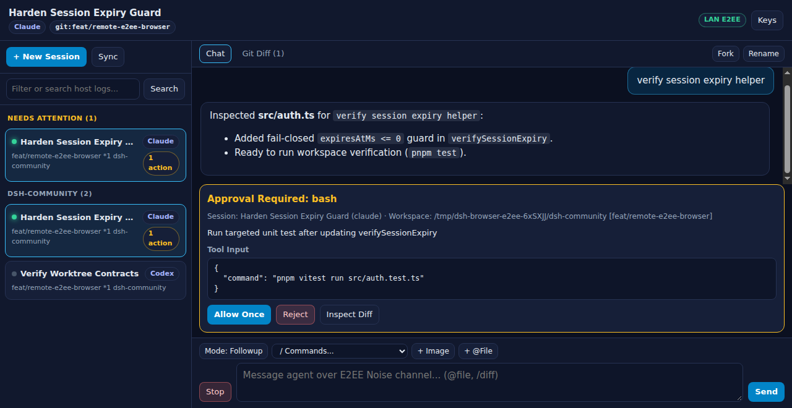
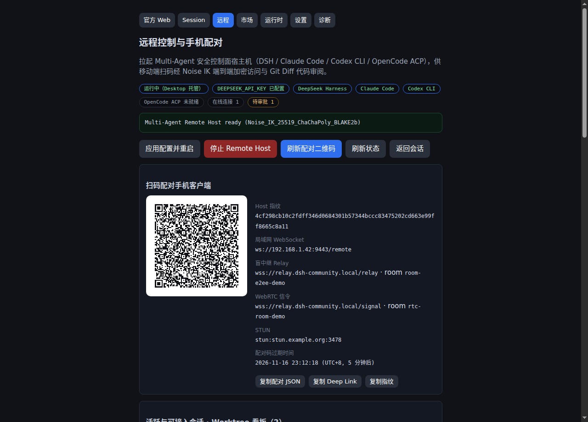

# DSH Community 使用指南

> 面向第一次使用者的任务型入口。最新机器事实以 [`current-release.json`](current-release.json) 为准。

[English](getting-started.en.md) · [返回中文 README](../README.md) · [发行端与实验端定义](community-endpoints.md) · [在线 Handbook](https://kamanager2012.github.io/dsh-community/)

## 先选正确入口

| 目标 | 入口 | 说明 |
| --- | --- | --- |
| 使用官方 Web 或 Windows / macOS 桌面 | [`deepseek-ai/deepseek-harness`](https://github.com/deepseek-ai/deepseek-harness)（`npx @deepseek-ai/dsh web`） | 官方上游产品与桌面路径，互补版不重复打包 Win/macOS |
| 使用社区终端 / TUI 与多引擎远程 | 本仓库 `dsh-community`、`pnpm tui` 或 `dsh-community remote start` | Linux / WSL 主力互补端，执行核心仍是官方 Runtime |
| 下载 Linux 桌面 AppImage | [Published Latest](https://github.com/kamanager2012/dsh-community/releases/latest) `.AppImage` 或 `pnpm desktop:package -- --appimage` | 官方未覆盖的 Linux 桌面互补端；精确 tag/文件名见 [`current-release.md`](current-release.md) |
| 下载 Android Remote Client APK | [Published Latest](https://github.com/kamanager2012/dsh-community/releases/latest) `-android-arm64-v8a.apk`（源码 `apps/android` + `packages/remote-adapter`） | 已签名 `arm64-v8a` APK（CI `x86_64` 模拟器 E2EE 已验收，物理真机遥测 `[UNVERIFIED]`） |
| 试用最新社区修复 | [Community Pre-release `v0.2.2-rc.3-community.1`](https://github.com/kamanager2012/dsh-community/releases/tag/v0.2.2-rc.3-community.1) | 预发布安装包与签名文件独立于 `releases/latest` 的 `v0.2.2-rc.3` |
| 查完整操作手册 | [DeepSeek Harness Handbook](https://kamanager2012.github.io/dsh-community/) | Provider、Session、安全、自动化和验收 |

**安装前先选发行频道：** GitHub Published Latest 仍是 `v0.2.2-rc.3`；最新 Community Pre-release 是 `v0.2.2-rc.3-community.1`。两者的安装包及校验文件不能混用。CLI 源码安装请使用 [README 的固定 Commit/Tag 示例](../README.md#30-秒极速上手)，不要误将可变 `main` 当成已签名的 Release。

不要从已归档的 Suite、独立 Marketplace、独立 Plugins 或 Edition 下载正式客户端。**Published Latest** 仍以 [releases/latest](https://github.com/kamanager2012/dsh-community/releases/latest) 和 `current-release.json` 中的 `githubLatestTag / publishedAssets / publishedReleaseEvidence` 为准；发行产物带 keyless cosign 签名（`.sigstore.json`）。不要下载历史编号 `v0.1.2`–`v0.1.6` 当当前产品。官方 Web 与 Windows/macOS Desktop 是上游端，不是 Community 互补端。三个互补 Community endpoints（全部已发行：WSL/Linux 终端、Linux AppImage 与已签名 Android `arm64-v8a` APK；其中 Android 物理真机遥测保持 `[UNVERIFIED]`）的定义见 [community-endpoints.md](community-endpoints.md)。详见[版本策略](version-policy.md)。

从源码运行时，Desktop/TUI 显示的是 **Candidate Source** 的 Dual-Badge，而不是 Published Latest 的版本号。候选 core、产品号、`candidateTag` 与 Dual-Badge 统一读取 [`current-release.json`](current-release.json)；源码候选可以领先于已发布下载。

## 当前已发布下载资产

在 [`releases/latest`](https://github.com/kamanager2012/dsh-community/releases/latest)（精确文件名与 SHA-256 摘要固定在 [`current-release.json`](current-release.json)），Complementary Edition 每次发行共上传 **12 个资产（3 个核心文件 + 3 个 `.sha256` + 6 个 keyless `.sigstore.json` 证明，不含 GitHub 自动源码归档；历史 `v0.1.1-rc.2` 之后已将 Windows `.exe` / macOS `.dmg` 交还官方上游）**：

- `dsh-community-<version>.AppImage` — Linux 桌面 AppImage（主程序）
- `dsh-community-<version>-android-arm64-v8a.apk` — Android Remote Client `arm64-v8a` 安装包（APK Signature Scheme v2/v3 + Keyless Cosign 双签名）
- `dsh-community-<version>-official-runtime.cdx.json` — 内嵌官方 `@deepseek-ai/dsh` 依赖树的 CycloneDX SBOM
- `*.sha256` 与 `*.sigstore.json` — 每个文件的 SHA-256 sidecar 与 keyless Cosign 签名包

本地完整性与无密钥签名校验（需 `cosign >= v2.4`，完整步骤见 [当前版本页面](current-release.md#quick-download--verification-v022-rc3)）：

```sh
sha256sum -c dsh-community-<version>.AppImage.sha256
cosign verify-blob \
  --bundle dsh-community-<version>.AppImage.sigstore.json \
  --certificate-oidc-issuer https://token.actions.githubusercontent.com \
  --certificate-identity "https://github.com/kamanager2012/dsh-community/.github/workflows/release.yml@refs/tags/v<version>" \
  dsh-community-<version>.AppImage

sha256sum -c dsh-community-<version>-android-arm64-v8a.apk.sha256
cosign verify-blob \
  --bundle dsh-community-<version>-android-arm64-v8a.apk.sigstore.json \
  --certificate-oidc-issuer https://token.actions.githubusercontent.com \
  --certificate-identity "https://github.com/kamanager2012/dsh-community/.github/workflows/release.yml@refs/tags/v<version>" \
  dsh-community-<version>-android-arm64-v8a.apk
```

第一次打开 Linux AppImage 会解一份官方 Runtime 到用户数据目录，只做一次。对话仍在官方 `~/.dsh`。

## 界面预览（Chromium E2EE 联调与桌面控制台页面）

以下两张截图由无头集成脚本 [`scripts/e2e/remote-web-browser-e2ee.mjs`](../scripts/e2e/remote-web-browser-e2ee.mjs) 自动生成，用于验证前端渲染与 Noise IK 加密链路（左图在真实无头 Chromium 中联调模拟 Claude/Codex 会话、审批与 Git Diff 夹具；右图为 Desktop HTML 视图渲染测试状态与已过期 `*.dsh-community.local` 演示二维码，并非运行独立打包 Electron 与真实外部 CLI 进程的现场截屏）：

| Browser PWA E2EE 联调（Chromium + 模拟多引擎夹具） | Desktop 远程控制台 HTML 预览（测试配对状态） |
| --- | --- |
|  |  |

## 三十秒一键安装终端（WSL / Linux）与五分钟从源码启动

`scripts/install-linux.sh` 是在 `v0.2.2-rc.3` 之后合入 `main` 的源码安装脚本（需要 Node.js 24.9+ / 最低 22.15、pnpm、git 与 `flock`（util-linux））。注意官方 `@deepseek-ai/dsh@0.2.2-rc.3` 声明 `engines.node >=24.9.0`（官方 0.1.0-rc.8 起 session JSONL 依赖 `node:zlib` zstd，22.15 才有）。直接安装或锁定精确 tag / commit：

```sh
# 跟踪 main 最新源码：
curl -fsSL https://raw.githubusercontent.com/kamanager2012/dsh-community/main/scripts/install-linux.sh | bash

# 或锁定到已发布 tag 与精确 Commit（v0.2.2-rc.3 = 073826c38df4cf246e7ac90b27e0df98569a534d）：
curl -fsSL https://raw.githubusercontent.com/kamanager2012/dsh-community/main/scripts/install-linux.sh | \
  bash -s -- --ref v0.2.2-rc.3 --expected-commit 073826c38df4cf246e7ac90b27e0df98569a534d
```

> 远程控制配对注意：
> - **同机浏览器 vs 手机跨设备**：`127.0.0.1` 只能在同一台机器的桌面浏览器访问（手机扫 `127.0.0.1` 会连回手机本身）；手机 LAN 直连请给 Android APK 使用 `--host <LAN-IP> --mdns`，手机浏览器 PWA 或公网访问请按 [deploy/relay/README.md](../deploy/relay/README.md) 部署 HTTPS/WSS 反向代理与 `--host-secret`，并在启动 `remote start` 时传入 `DSH_REMOTE_RELAY_HOST_SECRET` 与 `DSH_REMOTE_SIGNALING_HOST_SECRET`。
> - **默认最小权限**：首次配对仅自动授予 `['observe', 'prompt']`（只读会话/Git Diff 与发送 prompt），**不含 `approve`**；`--allow-caps observe,prompt,approve` 仅是配对令牌能力上限，真正授权需配对时在 REPL 执行 `confirm <candidateId> observe,prompt,approve`（或桌面确认勾选），或配对后执行 `dsh-community remote grant <deviceId> approve`。
> - **安全边界**：Noise IK 保护远控链路密文转发，不替代模型 Provider API 传输边界；`observe` 权限可读未提交 Git Diff；项目尚未完成独立第三方密码学安全审计。

或者手动克隆源码启动：

```sh
git clone https://github.com/kamanager2012/dsh-community.git
cd dsh-community
pnpm install
export DEEPSEEK_API_KEY=...
pnpm run doctor
pnpm start
```

Windows PowerShell 可以使用：

```powershell
$env:DEEPSEEK_API_KEY = "..."
pnpm run doctor
pnpm start
```

`doctor` 是启动前检查，不会替你验证模型调用已经成功。首次任务完成后仍应检查实际输出、`git diff` 和退出状态。

## 常用入口

```sh
dsh-community                 # 有可恢复会话时继续最近会话
dsh-community new             # 新建会话
dsh-community resume last     # 恢复最近会话
dsh-community sessions        # 查看官方会话列表
dsh-community doctor          # 检查运行环境
dsh-community version         # 查看社区层版本信息
dsh-community plugins         # 只读查看插件目录
dsh-community desktop         # 启动桌面壳
```

源码开发时也可以使用 `pnpm start`、`pnpm new`、`pnpm run doctor`、`pnpm desktop`。不要裸跑 `pnpm doctor`（那是 pnpm 自己的命令）。插件安装不要由社区层重新实现，继续使用官方 `dsh plugin add` 链路或 Desktop 市场页。

## 会话和数据边界

- 官方 Session 真源仍在 `~/.dsh`；Community 不维护第二套等价 Session persistence。
- `new`、`resume` 和 `sessions` 是入口体验，不代表社区层拥有官方 Session 数据格式。
- 需要备份、恢复、事件阅读或自动化时，先看 Handbook 的 [Session 章节](https://kamanager2012.github.io/dsh-community/content/07-sessions/)。
- 不要把 API key、私有 Session 或客户数据放进仓库、截图或 issue。

## 插件路径

```text
packages/marketplace/catalog.json
          ↓ 兼容性和验证信息
      packages/marketplace（CLI：dsh-marketplace / pnpm marketplace）
          ↓ 用户选择
官方 dsh plugin add / 官方安装链
```

注册表不是安全保证，也不替代官方安装器。没有匹配 `testedDsh` 线的条目应按 `[UNVERIFIED]` 处理。

- [插件目录 catalog.json](../packages/marketplace/catalog.json)
- [Marketplace 使用说明](../packages/marketplace/docs/usage.md)
- [插件验证指南](../packages/marketplace/docs/registry-guide.md)

## 常见问题

| 症状 | 先检查 | 不要做什么 |
| --- | --- | --- |
| `dsh-community: command not found` | 先用源码命令，或确认安装包 PATH | 不要把本仓库发布成 `@deepseek-ai/dsh` |
| 没有模型响应 | `DEEPSEEK_API_KEY`、Provider 配置和 `dsh web --help` | 不要把 `doctor` 通过当成模型调用通过 |
| 端口被占用 | `doctor` 输出和官方 `dsh web` 进程 | 不要用 `killall node` 误杀其他项目 |
| 不知道下载哪个版本 | [Published Latest](https://github.com/kamanager2012/dsh-community/releases/latest) | 精确 tag / 文件名看 `current-release.json`；不要下历史 `v0.1.2`–`v0.1.6` |
| 想试未发布的 SDK / Checkpoint 实验 | 那些实验已随 Labs 仓归档，不是产品通道 | 不要从归档仓安装 |

## 继续阅读

- [架构边界](../ARCHITECTURE.md)
- [发布指南](release.md)
- [升级说明](upgrade.md)
- [契约快照](../contracts/README.md)
- [生态说明](../ECOSYSTEM.md)
- [官方 Runtime](https://github.com/deepseek-ai/deepseek-harness)
